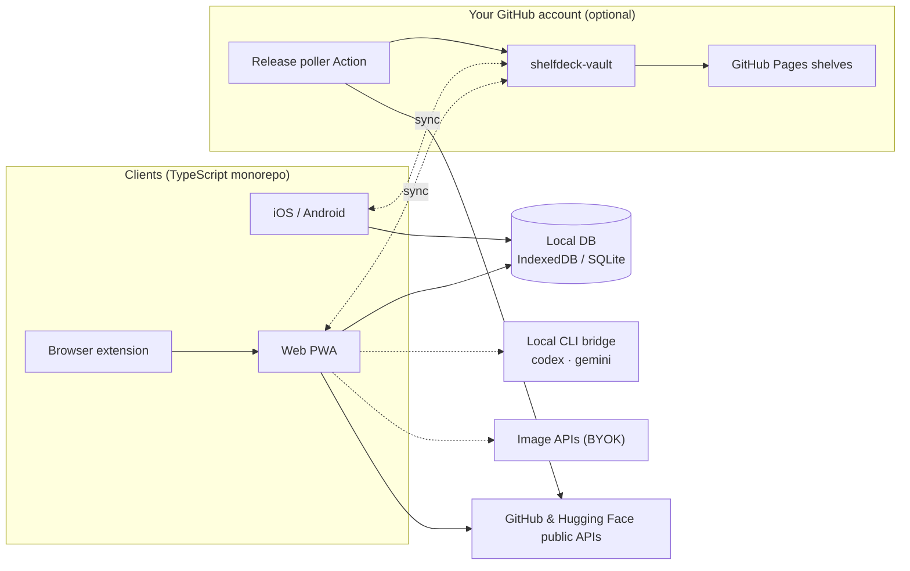

<div align="center">

<a href="https://datarecoveryexpert.github.io/shelfdeck/">
  <picture>
    <source media="(prefers-color-scheme: dark)" srcset="site/assets/img/logo-wordmark-dark.png">
    
  </picture>
</a>

<p><strong>Your developer library, as a media center.</strong><br>
Turn GitHub stars, Hugging Face models and dev tools into a visual, searchable poster wall, with release tracking that stays out of your inbox.</p>

<p>
  <a href="https://datarecoveryexpert.github.io/shelfdeck/"><strong>Website</strong></a> ·
  <a href="CONTRIBUTING.md"><strong>Contribute</strong></a>
</p>

<p>
  
  <a href="LICENSE"></a>
  
  
  <a href="https://github.com/datarecoveryexpert/shelfdeck/stargazers"></a>
</p>

<p>
  <b>English</b> ·
  <a href="docs/i18n/README.tr.md">Türkçe</a> ·
  <a href="docs/i18n/README.fr.md">Français</a> ·
  <a href="docs/i18n/README.es.md">Español</a> ·
  <a href="docs/i18n/README.zh-CN.md">简体中文</a> ·
  <a href="docs/i18n/README.ja.md">日本語</a>
</p>


</div>

> [!NOTE]
> **ShelfDeck is in the design and specification phase.** There is no usable release yet, and the screens below are design mockups of the planned product. Star or watch the repo to hear when the first build ships.

## Why ShelfDeck?

Developers star hundreds of repositories and like dozens of models every month. A few weeks later nobody remembers why something was saved, which project it was meant for, or that it shipped a breaking `v2.0` in the meantime.

ShelfDeck replaces the flat star list with a library you can actually browse:

| The problem | What ShelfDeck does |
| :--- | :--- |
| **The star graveyard.** Saved items lose all personal context. | Shelves, tags, notes and an adoption status (`Inbox`, `Want to Try`, `Using`, `Reference`, `Archived`) on every item. |
| **No visual memory.** `owner/repo` strings all look the same. | Each item gets a 2:3 poster cover: upstream artwork, a procedural poster, or AI art you generate yourself. |
| **Missed releases.** Watching a repo floods your inbox with issue noise. | A quiet release feed for the items you choose to track, with breaking changes flagged. |
| **Device fragmentation.** Discover on the phone, evaluate on the laptop. | Optional sync through a private repo in *your own* GitHub account. No ShelfDeck server, no subscription. |

## A look at the experience

<p align="center"><br><sub>Popular projects as ShelfDeck would shelve them. Design concept; names and artwork belong to their owners.</sub></p>

<table>
  <tr>
    <td width="50%"><br><sub><b>Home.</b> Paste a URL, browse Kodi-style shelf rows.</sub></td>
    <td width="50%"><br><sub><b>Detail.</b> Backdrop view with notes, license, releases and quick actions.</sub></td>
  </tr>
  <tr>
    <td><br><sub><b>Table.</b> A dense, sortable view with maintenance health signals.</sub></td>
    <td><br><sub><b>Kanban.</b> Drag items through your adoption pipeline.</sub></td>
  </tr>
  <tr>
    <td><br><sub><b>Poster grid.</b> Facets for source, language, task, license, status and shelf.</sub></td>
    <td><br><sub><b>Releases.</b> A quiet feed for tracked items, breaking changes flagged.</sub></td>
  </tr>
  <tr>
    <td><br><sub><b>Radar.</b> Your personal tech radar.</sub></td>
    <td><br><sub><b>Health.</b> Stale items, license mix and compatibility warnings.</sub></td>
  </tr>
  <tr>
    <td><br><sub><b>Compare.</b> Up to four alternatives side by side.</sub></td>
    <td><br><sub><b>Stacks.</b> Project recipes with "depends on" and "alternative to" links.</sub></td>
  </tr>
  <tr>
    <td><br><sub><b>Ctrl K.</b> "I need a library that does X" across titles, tags and notes.</sub></td>
    <td><br><sub><b>Settings.</b> All three tiers in one place; keys stay on device.</sub></td>
  </tr>
  <tr>
    <td><br><sub><b>Share.</b> Publish a shelf to GitHub Pages or export an awesome-list.</sub></td>
    <td><br><sub><b>Mobile.</b> Poster grid, detail and Share Sheet capture.</sub></td>
  </tr>
</table>

## Start instantly, grow optionally

<table>
  <tr>
    <td width="33%" valign="top">
      <br>
      <h3>1 · Instant local library</h3>
      <p>No signup, no token. Paste a GitHub or Hugging Face URL, metadata is fetched once from public APIs and stored in your browser. Works offline from then on.</p>
    </td>
    <td width="33%" valign="top">
      <br>
      <h3>2 · Release tracking &amp; AI covers</h3>
      <p>Add your own GitHub PAT or Hugging Face token to bulk-import stars and likes, track releases and generate covers. Keys stay on your device.</p>
    </td>
    <td width="33%" valign="top">
      <br>
      <h3>3 · Sync &amp; share</h3>
      <p>Connect GitHub to create a private <code>shelfdeck-vault</code> repo. Sync Web, iOS and Android through it and publish shelves to GitHub Pages.</p>
    </td>
  </tr>
</table>

## Features

- **Media-center browsing.** Poster grid, shelf carousels, a theatrical detail view and a `Ctrl+K` command palette.
- **Deep GitHub & Hugging Face metadata.** Stars, license, language, topics, latest release, model parameters, pipeline task and quantizations.
- **Views for real work.** Table, Kanban, timeline, side-by-side comparison, a tech radar and a library health dashboard.
- **Smart tags and collections.** Auto-tags from metadata (`lang:rust`, `task:tts`, `license:mit`), rule-based smart shelves and a "find alternative" action.
- **Stacks and relationships.** Group items into project recipes and record "depends on", "alternative to" and "replaces" links.
- **License and risk signals.** Compatibility warnings, maintenance health badges and breaking-change flags.
- **Browser extension.** A "Save to ShelfDeck" button on GitHub and Hugging Face pages.
- **Share your curation.** Publish shelves as a visual gallery on GitHub Pages or export them as an `awesome-list` Markdown file.

<p align="center"></p>

## The cover engine

Most repositories have no poster art, so ShelfDeck makes some. Every cover is produced on your own device:

1. **Extract.** Custom social previews and README hero images, with generic boilerplate cards and badges filtered out.
2. **Procedural.** Deterministic, zero-cost SVG posters in themes such as *Criterion Dev*, *Terminal Blueprint* and *Model Spec Card*.
3. **AI.** Your existing `codex` or `gemini` CLI subscription through a local bridge, or your own key for OpenAI, Gemini, fal.ai, Replicate, Together AI or a local ComfyUI.

<table>
  <tr>
    <td width="50%"><br><sub><b>Procedural themes.</b> Criterion Dev, Terminal Blueprint, Model Spec Card.</sub></td>
    <td width="50%"><br><sub><b>Cover studio.</b> Procedural, local CLI bridge or your own image API.</sub></td>
  </tr>
</table>

## Architecture



Solid lines work without any account. Dashed lines are opt-in. There is no ShelfDeck backend and no central user database.

## Roadmap

| Phase | Focus | Status |
| :--- | :--- | :--- |
| 1 | Foundation & web MVP: local library, procedural covers, views, project site | 🟡 In design |
| 2 | Browser extension, tokens, bulk import, release tracking, awesome-list export | ⚪ Planned |
| 3 | Vault sync, release-poller Action, public shelf galleries | ⚪ Planned |
| 4 | Local CLI bridge and multi-provider cover studio | ⚪ Planned |
| 5 | iOS & Android apps with Share Sheet capture | ⚪ Planned |
| 6 | Package registries, AI release digest, community themes | ⚪ Planned |

## Planned monorepo layout

```text
shelfdeck/
├── apps/
│   ├── web/            # Next.js PWA and static public shelf viewer
│   ├── mobile/         # Expo (React Native) for iOS and Android
│   └── extension/      # Chrome / Firefox extension (Manifest V3)
├── packages/
│   ├── core/           # Source parsers, Zod schemas, exporters
│   ├── sync-engine/    # Git Trees API sync, diff and merge
│   ├── cover-engine/   # Procedural posters and AI provider adapters
│   ├── local-bridge/   # Node CLI bridging local codex / gemini
│   └── ui/             # Design tokens and poster primitives
├── templates/vault-starter/
└── docs/
```

## Contributing

ShelfDeck is designed with four low-friction contribution surfaces: **poster themes**, **source adapters**, **image provider adapters** and **translations**. Most of them need no knowledge of sync or auth code. Start with [CONTRIBUTING.md](CONTRIBUTING.md), and please follow the [Code of Conduct](CODE_OF_CONDUCT.md).

Found a security issue? Please read [SECURITY.md](SECURITY.md) instead of opening a public issue.

## Maintainer

ShelfDeck is created and maintained by **a.ceyhan** ([@datarecoveryexpert](https://github.com/datarecoveryexpert)), forensic expert at **GOLD DATA Teknoloji**, İstanbul.

- Web: <https://www.goldverikurtarma.com>
- E-mail: [a.ceyhan@goldverikurtarma.com](mailto:a.ceyhan@goldverikurtarma.com)
- Other projects: [Tahlis™ DiskNabız](https://github.com/datarecoveryexpert/Tahlis-DiskNabiz), a free, telemetry-free disk health monitor for Windows

## Brand

<p align="center"></p>

Paper `#FAF8F4` · Ink `#14161C` · Amber `#F2A516` · Teal `#0E8F80` · Coral `#E5533D`. Logo files live in [`site/assets/img`](site/assets/img).

## License

[MIT](LICENSE) © 2026 GOLD DATA Teknoloji
