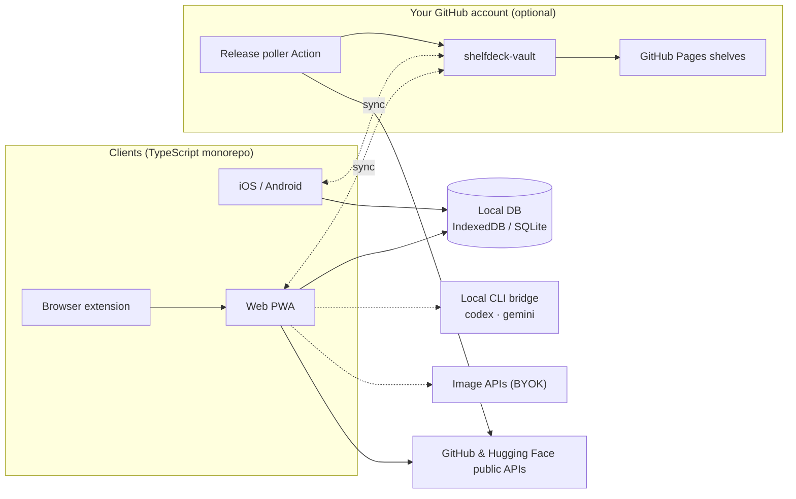

<div align="center">

<a href="https://datarecoveryexpert.github.io/shelfdeck/">
  <picture>
    <source media="(prefers-color-scheme: dark)" srcset="../../site/assets/img/logo-wordmark-dark.png">
    
  </picture>
</a>

<p><strong>Tu biblioteca de desarrollador, convertida en un media center.</strong><br>
Convierte tus estrellas de GitHub, modelos de Hugging Face y herramientas de desarrollo en un muro de pósteres visual y con búsqueda, con un seguimiento de releases que no te llena la bandeja de entrada.</p>

<p>
  <a href="https://datarecoveryexpert.github.io/shelfdeck/"><strong>Sitio web</strong></a> ·
  <a href="../../CONTRIBUTING.md"><strong>Contribuir</strong></a>
</p>

<p>
  
  <a href="../../LICENSE"></a>
  
  
  <a href="https://github.com/datarecoveryexpert/shelfdeck/stargazers"></a>
</p>

<p>
  <a href="../../README.md">English</a> ·
  <a href="README.tr.md">Türkçe</a> ·
  <a href="README.fr.md">Français</a> ·
  <b>Español</b> ·
  <a href="README.zh-CN.md">简体中文</a> ·
  <a href="README.ja.md">日本語</a>
</p>


</div>

> [!NOTE]
> **ShelfDeck está en fase de diseño y especificación.** Todavía no hay ninguna versión utilizable, y las pantallas que verás abajo son maquetas del producto previsto. Dale una estrella o sigue el repositorio para enterarte cuando salga la primera build.

## ¿Por qué ShelfDeck?

Cada mes, los desarrolladores marcan con estrella cientos de repositorios y dan like a decenas de modelos. Unas semanas después, nadie recuerda por qué guardó algo, para qué proyecto era, ni que mientras tanto ha salido una `v2.0` con cambios incompatibles.

ShelfDeck sustituye esa lista plana de estrellas por una biblioteca que de verdad apetece recorrer:

| El problema | Lo que hace ShelfDeck |
| :--- | :--- |
| **El cementerio de estrellas.** Lo que guardas pierde todo el contexto personal. | Estanterías, etiquetas, notas y un estado de adopción (`Inbox`, `Want to Try`, `Using`, `Reference`, `Archived`) en cada elemento. |
| **Sin memoria visual.** Todas las cadenas `owner/repo` parecen iguales. | Cada elemento recibe un póster en formato 2:3: la imagen original del proyecto, un póster procedural o arte con IA que generas tú mismo. |
| **Releases que se te escapan.** Hacer watch a un repo te inunda el correo con ruido de issues. | Un feed de releases tranquilo solo para los elementos que decides seguir, con los cambios incompatibles marcados. |
| **Dispositivos dispersos.** Descubres en el móvil y evalúas en el portátil. | Sincronización opcional mediante un repositorio privado en *tu propia* cuenta de GitHub. Sin servidor de ShelfDeck y sin suscripción. |

## Un vistazo a la experiencia

<p align="center"><br><sub>Proyectos populares, organizados como lo haría ShelfDeck. Concepto de diseño; los nombres y las imágenes pertenecen a sus propietarios.</sub></p>

<table>
  <tr>
    <td width="50%"><br><sub><b>Inicio.</b> Pega una URL y navega por filas de estanterías al estilo Kodi.</sub></td>
    <td width="50%"><br><sub><b>Detalle.</b> Vista con fondo, notas, licencia, releases y acciones rápidas.</sub></td>
  </tr>
  <tr>
    <td><br><sub><b>Tabla.</b> Una vista densa y ordenable con indicadores del estado de mantenimiento.</sub></td>
    <td><br><sub><b>Kanban.</b> Arrastra elementos a lo largo de tu flujo de adopción.</sub></td>
  </tr>
  <tr>
    <td><br><sub><b>Cuadrícula de pósteres.</b> Filtros por fuente, lenguaje, tarea, licencia, estado y estantería.</sub></td>
    <td><br><sub><b>Releases.</b> Un feed tranquilo para lo que sigues, con los cambios incompatibles marcados.</sub></td>
  </tr>
  <tr>
    <td><br><sub><b>Radar.</b> Tu radar tecnológico personal.</sub></td>
    <td><br><sub><b>Salud.</b> Elementos abandonados, reparto de licencias y avisos de compatibilidad.</sub></td>
  </tr>
  <tr>
    <td><br><sub><b>Comparar.</b> Hasta cuatro alternativas lado a lado.</sub></td>
    <td><br><sub><b>Stacks.</b> Recetas de proyecto con vínculos «depende de» y «alternativa a».</sub></td>
  </tr>
  <tr>
    <td><br><sub><b>Ctrl K.</b> «Necesito una librería que haga X», buscando en títulos, etiquetas y notas.</sub></td>
    <td><br><sub><b>Ajustes.</b> Los tres niveles en un solo sitio; las claves no salen del dispositivo.</sub></td>
  </tr>
  <tr>
    <td><br><sub><b>Compartir.</b> Publica una estantería en GitHub Pages o expórtala como awesome-list.</sub></td>
    <td><br><sub><b>Móvil.</b> Cuadrícula de pósteres, vista de detalle y captura desde el menú Compartir.</sub></td>
  </tr>
</table>

## Empieza al momento, crece si quieres

<table>
  <tr>
    <td width="33%" valign="top">
      <br>
      <h3>1 · Biblioteca local al instante</h3>
      <p>Sin registro y sin token. Pega una URL de GitHub o Hugging Face: los metadatos se obtienen una sola vez de las API públicas y se guardan en tu navegador. A partir de ahí funciona sin conexión.</p>
    </td>
    <td width="33%" valign="top">
      <br>
      <h3>2 · Seguimiento de releases y pósteres con IA</h3>
      <p>Añade tu propio PAT de GitHub o token de Hugging Face para importar en bloque tus estrellas y likes, seguir releases y generar pósteres. Las claves no salen de tu dispositivo.</p>
    </td>
    <td width="33%" valign="top">
      <br>
      <h3>3 · Sincroniza y comparte</h3>
      <p>Conecta GitHub para crear un repositorio privado <code>shelfdeck-vault</code>. A través de él se sincronizan Web, iOS y Android, y puedes publicar estanterías en GitHub Pages.</p>
    </td>
  </tr>
</table>

## Funcionalidades

- **Navegación tipo media center.** Cuadrícula de pósteres, carruseles de estanterías, una vista de detalle de cine y una paleta de comandos con `Ctrl+K`.
- **Metadatos completos de GitHub y Hugging Face.** Estrellas, licencia, lenguaje, topics, última release, parámetros del modelo, tarea del pipeline y cuantizaciones.
- **Vistas para trabajar de verdad.** Tabla, Kanban, línea temporal, comparación lado a lado, un radar tecnológico y un panel de salud de la biblioteca.
- **Etiquetas inteligentes y colecciones.** Etiquetas automáticas a partir de los metadatos (`lang:rust`, `task:tts`, `license:mit`), estanterías inteligentes basadas en reglas y una acción de «buscar alternativa».
- **Stacks y relaciones.** Agrupa elementos en recetas de proyecto y registra vínculos como «depende de», «alternativa a» y «reemplaza a».
- **Señales de licencia y riesgo.** Avisos de compatibilidad, insignias de estado de mantenimiento y marcas de cambios incompatibles.
- **Extensión de navegador.** Un botón «Save to ShelfDeck» en las páginas de GitHub y Hugging Face.
- **Comparte tu selección.** Publica estanterías como galería visual en GitHub Pages o expórtalas a un archivo Markdown estilo `awesome-list`.

<p align="center"></p>

## El motor de pósteres

La mayoría de los repositorios no tienen póster, así que ShelfDeck se los crea. Cada póster se genera en tu propio dispositivo:

1. **Extracción.** Vistas previas sociales personalizadas e imágenes de cabecera de los README, descartando tarjetas genéricas e insignias.
2. **Procedural.** Pósteres SVG deterministas y sin coste, con temas como *Criterion Dev*, *Terminal Blueprint* y *Model Spec Card*.
3. **IA.** Tu suscripción actual a la CLI de `codex` o `gemini` a través de un puente local, o tu propia clave de OpenAI, Gemini, fal.ai, Replicate, Together AI o un ComfyUI local.

<table>
  <tr>
    <td width="50%"><br><sub><b>Temas procedurales.</b> Criterion Dev, Terminal Blueprint, Model Spec Card.</sub></td>
    <td width="50%"><br><sub><b>Estudio de pósteres.</b> Procedural, puente CLI local o tu propia API de imágenes.</sub></td>
  </tr>
</table>

## Arquitectura



Las líneas continuas funcionan sin ninguna cuenta. Las discontinuas son opcionales. No hay backend de ShelfDeck ni base de datos central de usuarios.

## Hoja de ruta

| Fase | Enfoque | Estado |
| :--- | :--- | :--- |
| 1 | Base y MVP web: biblioteca local, pósteres procedurales, vistas, sitio del proyecto | 🟡 En diseño |
| 2 | Extensión de navegador, tokens, importación masiva, seguimiento de releases, exportación awesome-list | ⚪ Planificado |
| 3 | Sincronización del vault, Action de sondeo de releases, galerías públicas de estanterías | ⚪ Planificado |
| 4 | Puente CLI local y estudio de pósteres con varios proveedores | ⚪ Planificado |
| 5 | Apps para iOS y Android con captura desde el menú Compartir | ⚪ Planificado |
| 6 | Registros de paquetes, resumen de releases con IA, temas de la comunidad | ⚪ Planificado |

## Estructura prevista del monorepo

```text
shelfdeck/
├── apps/
│   ├── web/            # Next.js PWA and static public shelf viewer
│   ├── mobile/         # Expo (React Native) for iOS and Android
│   └── extension/      # Chrome / Firefox extension (Manifest V3)
├── packages/
│   ├── core/           # Source parsers, Zod schemas, exporters
│   ├── sync-engine/    # Git Trees API sync, diff and merge
│   ├── cover-engine/   # Procedural posters and AI provider adapters
│   ├── local-bridge/   # Node CLI bridging local codex / gemini
│   └── ui/             # Design tokens and poster primitives
├── templates/vault-starter/
└── docs/
```

## Contribuir

ShelfDeck está pensado con cuatro vías de contribución muy accesibles: **temas de pósteres**, **adaptadores de fuentes**, **adaptadores de proveedores de imágenes** y **traducciones**. La mayoría no requieren conocer el código de sincronización ni de autenticación. Empieza por [CONTRIBUTING.md](../../CONTRIBUTING.md) y, por favor, respeta el [Código de conducta](../../CODE_OF_CONDUCT.md).

¿Has encontrado un problema de seguridad? Lee [SECURITY.md](../../SECURITY.md) en lugar de abrir una issue pública.

## Mantenedor

ShelfDeck lo crea y mantiene **a.ceyhan** ([@datarecoveryexpert](https://github.com/datarecoveryexpert)), perito forense en **GOLD DATA Teknoloji**, Estambul.

- Web: <https://www.goldverikurtarma.com>
- Correo: [a.ceyhan@goldverikurtarma.com](mailto:a.ceyhan@goldverikurtarma.com)
- Otros proyectos: [Tahlis™ DiskNabız](https://github.com/datarecoveryexpert/Tahlis-DiskNabiz), un monitor de salud de discos para Windows, gratuito y sin telemetría

## Marca

<p align="center"></p>

Paper `#FAF8F4` · Ink `#14161C` · Amber `#F2A516` · Teal `#0E8F80` · Coral `#E5533D`. Los archivos del logotipo están en [`site/assets/img`](../../site/assets/img).

## Licencia

[MIT](../../LICENSE) © 2026 GOLD DATA Teknoloji
