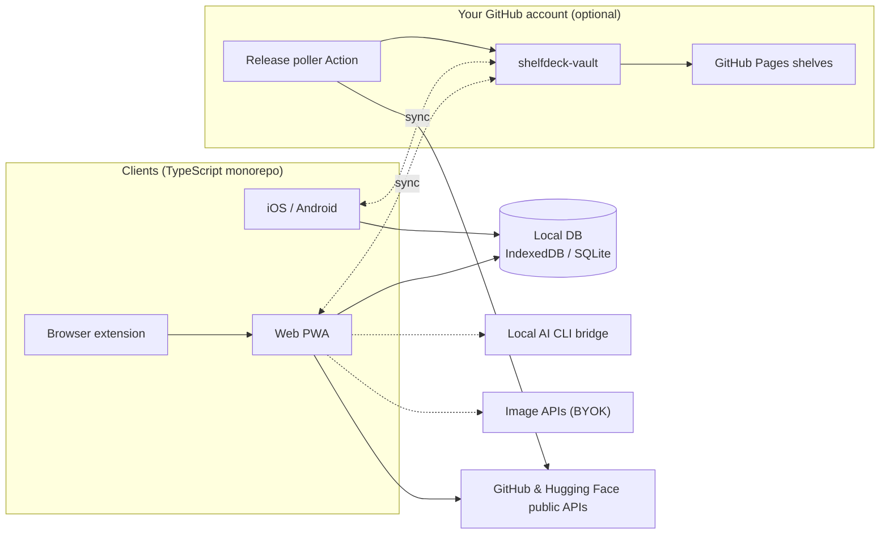

<div align="center">

<a href="https://datarecoveryexpert.github.io/shelfdeck/">
  <picture>
    <source media="(prefers-color-scheme: dark)" srcset="../../site/assets/img/logo-wordmark-dark.png">
    
  </picture>
</a>

<p><strong>Votre bibliothèque de développeur, façon media center.</strong><br>
Transformez vos étoiles GitHub, vos modèles Hugging Face et vos outils de dev en un mur d'affiches visuel et consultable, avec un suivi des releases qui ne vient pas encombrer votre boîte mail.</p>

<p>
  <a href="https://datarecoveryexpert.github.io/shelfdeck/"><strong>Site web</strong></a> ·
  <a href="../../CONTRIBUTING.md"><strong>Contribuer</strong></a>
</p>

<p>
  
  <a href="../../LICENSE"></a>
  
  
  <a href="https://github.com/datarecoveryexpert/shelfdeck/stargazers"></a>
</p>

<p>
  <a href="../../README.md">English</a> ·
  <a href="README.tr.md">Türkçe</a> ·
  <b>Français</b> ·
  <a href="README.es.md">Español</a> ·
  <a href="README.zh-CN.md">简体中文</a> ·
  <a href="README.ja.md">日本語</a>
</p>


</div>

> [!NOTE]
> **ShelfDeck est en phase de conception et de spécification.** Aucune version utilisable n'existe encore, et les écrans ci-dessous sont des maquettes du produit prévu. Ajoutez une étoile ou suivez le dépôt pour être prévenu de la sortie du premier build.

## Pourquoi ShelfDeck ?

Chaque mois, les développeurs mettent des étoiles à des centaines de dépôts et des « likes » à des dizaines de modèles. Quelques semaines plus tard, plus personne ne se souvient pourquoi tel élément a été gardé, pour quel projet il devait servir, ni qu'il a entre-temps publié une `v2.0` qui casse tout.

ShelfDeck remplace la liste d'étoiles toute plate par une bibliothèque qu'on a vraiment envie de parcourir :

| Le problème | Ce que fait ShelfDeck |
| :--- | :--- |
| **Le cimetière d'étoiles.** Les éléments sauvegardés perdent tout contexte personnel. | Des étagères, des tags, des notes et un statut d'adoption (`Inbox`, `Want to Try`, `Using`, `Reference`, `Archived`) sur chaque élément. |
| **Aucune mémoire visuelle.** Toutes les chaînes `owner/repo` se ressemblent. | Chaque élément reçoit une affiche au format 2:3 : le visuel d'origine, une affiche procédurale ou une illustration IA que vous générez vous-même. |
| **Des releases ratées.** Suivre un dépôt inonde votre boîte mail de notifications d'issues. | Un fil de releases discret pour les seuls éléments que vous choisissez de suivre, avec les changements cassants signalés. |
| **Des appareils éparpillés.** On découvre sur le téléphone, on évalue sur le portable. | Une synchronisation optionnelle via un dépôt privé sur *votre propre* compte GitHub. Pas de serveur ShelfDeck, pas d'abonnement. |

## Aperçu de l'expérience

<p align="center"><br><sub>Des projets populaires, rangés comme ShelfDeck le ferait. Concept de design ; les noms et visuels appartiennent à leurs propriétaires.</sub></p>

<table>
  <tr>
    <td width="50%"><br><sub><b>Accueil.</b> Collez une URL et parcourez des rangées d'étagères façon Kodi.</sub></td>
    <td width="50%"><br><sub><b>Détail.</b> Vue avec arrière-plan, notes, licence, releases et actions rapides.</sub></td>
  </tr>
  <tr>
    <td><br><sub><b>Tableau.</b> Une vue dense et triable, avec des indicateurs de santé de la maintenance.</sub></td>
    <td><br><sub><b>Kanban.</b> Faites glisser les éléments le long de votre pipeline d'adoption.</sub></td>
  </tr>
  <tr>
    <td><br><sub><b>Grille d'affiches.</b> Filtres par source, langage, tâche, licence, statut et étagère.</sub></td>
    <td><br><sub><b>Releases.</b> Un fil discret pour les éléments suivis, changements cassants signalés.</sub></td>
  </tr>
  <tr>
    <td><br><sub><b>Radar.</b> Votre radar technologique personnel.</sub></td>
    <td><br><sub><b>Santé.</b> Éléments à l'abandon, répartition des licences et alertes de compatibilité.</sub></td>
  </tr>
  <tr>
    <td><br><sub><b>Comparer.</b> Jusqu'à quatre alternatives côte à côte.</sub></td>
    <td><br><sub><b>Stacks.</b> Des recettes de projet avec des liens « dépend de » et « alternative à ».</sub></td>
  </tr>
  <tr>
    <td><br><sub><b>Ctrl K.</b> « Il me faut une bibliothèque qui fait X », cherché dans les titres, les tags et les notes.</sub></td>
    <td><br><sub><b>Paramètres.</b> Les trois niveaux au même endroit ; les clés restent sur l'appareil.</sub></td>
  </tr>
  <tr>
    <td><br><sub><b>Partager.</b> Publiez une étagère sur GitHub Pages ou exportez-la en awesome-list.</sub></td>
    <td><br><sub><b>Mobile.</b> Grille d'affiches, vue détaillée et capture depuis le menu Partager.</sub></td>
  </tr>
</table>

## Démarrez tout de suite, allez plus loin si vous le souhaitez

<table>
  <tr>
    <td width="33%" valign="top">
      <br>
      <h3>1 · Bibliothèque locale instantanée</h3>
      <p>Pas d'inscription, pas de token. Collez une URL GitHub ou Hugging Face : les métadonnées sont récupérées une seule fois via les API publiques et stockées dans votre navigateur. Tout fonctionne ensuite hors ligne.</p>
    </td>
    <td width="33%" valign="top">
      <br>
      <h3>2 · Suivi des releases &amp; affiches IA</h3>
      <p>Ajoutez votre propre PAT GitHub ou token Hugging Face pour importer en masse vos étoiles et vos likes, suivre les releases et générer des affiches. Vos clés restent sur votre appareil.</p>
    </td>
    <td width="33%" valign="top">
      <br>
      <h3>3 · Synchronisation &amp; partage</h3>
      <p>Connectez GitHub pour créer un dépôt privé <code>shelfdeck-vault</code>. Il sert à synchroniser le Web, iOS et Android, et à publier vos étagères sur GitHub Pages.</p>
    </td>
  </tr>
</table>

## Fonctionnalités

- **Navigation façon media center.** Grille d'affiches, carrousels d'étagères, une vue détaillée digne d'une salle de cinéma et une palette de commandes `Ctrl+K`.
- **Métadonnées GitHub & Hugging Face complètes.** Étoiles, licence, langage, topics, dernière release, nombre de paramètres des modèles, tâche de pipeline et quantifications.
- **Des vues pensées pour le travail.** Tableau, Kanban, frise chronologique, comparaison côte à côte, radar technologique et tableau de bord de santé de la bibliothèque.
- **Tags intelligents et collections.** Tags automatiques issus des métadonnées (`lang:rust`, `task:tts`, `license:mit`), étagères intelligentes basées sur des règles et une action « trouver une alternative ».
- **Stacks et relations.** Regroupez des éléments en recettes de projet et notez les liens « dépend de », « alternative à » et « remplace ».
- **Signaux de licence et de risque.** Alertes de compatibilité, badges de santé de la maintenance et marqueurs de changements cassants.
- **Extension de navigateur.** Un bouton « Save to ShelfDeck » sur les pages GitHub et Hugging Face.
- **Partagez votre sélection.** Publiez vos étagères sous forme de galerie visuelle sur GitHub Pages ou exportez-les dans un fichier Markdown au format `awesome-list`.

<p align="center"></p>

## Le moteur d'affiches

La plupart des dépôts n'ont pas d'affiche, alors ShelfDeck en fabrique. Chaque affiche est produite sur votre propre appareil :

1. **Extraction.** Aperçus sociaux personnalisés et images d'en-tête des README, en écartant les cartes génériques et les badges.
2. **Procédural.** Des affiches SVG déterministes et gratuites, avec des thèmes comme *Criterion Dev*, *Terminal Blueprint* et *Model Spec Card*.
3. **IA.** Un outil d'IA en ligne de commande auquel vous êtes déjà abonné, via un pont local, ou votre propre clé d'API de génération d'images ou un GPU local.

<table>
  <tr>
    <td width="50%"><br><sub><b>Thèmes procéduraux.</b> Criterion Dev, Terminal Blueprint, Model Spec Card.</sub></td>
    <td width="50%"><br><sub><b>Studio d'affiches.</b> Procédural, pont CLI local ou votre propre API d'images.</sub></td>
  </tr>
</table>

## Architecture



Les traits pleins fonctionnent sans aucun compte. Les traits pointillés sont optionnels. Il n'y a ni backend ShelfDeck ni base d'utilisateurs centralisée.

## Feuille de route

| Phase | Objectif | Statut |
| :--- | :--- | :--- |
| 1 | Fondations & MVP web : bibliothèque locale, affiches procédurales, vues, site du projet | 🟡 En conception |
| 2 | Extension de navigateur, tokens, import en masse, suivi des releases, export awesome-list | ⚪ Prévu |
| 3 | Synchronisation du vault, Action de surveillance des releases, galeries d'étagères publiques | ⚪ Prévu |
| 4 | Pont CLI local et studio d'affiches multi-fournisseurs | ⚪ Prévu |
| 5 | Applications iOS & Android avec capture depuis le menu Partager | ⚪ Prévu |
| 6 | Registres de paquets, résumé IA des releases, thèmes communautaires | ⚪ Prévu |

## Organisation prévue du monorepo

```text
shelfdeck/
├── apps/
│   ├── web/            # Next.js PWA and static public shelf viewer
│   ├── mobile/         # Expo (React Native) for iOS and Android
│   └── extension/      # Chrome / Firefox extension (Manifest V3)
├── packages/
│   ├── core/           # Source parsers, Zod schemas, exporters
│   ├── sync-engine/    # Git Trees API sync, diff and merge
│   ├── cover-engine/   # Procedural posters and AI provider adapters
│   ├── local-bridge/   # Node CLI bridging local AI CLIs
│   └── ui/             # Design tokens and poster primitives
├── templates/vault-starter/
└── docs/
```

## Contribuer

ShelfDeck a été pensé avec quatre points d'entrée simples pour contribuer : les **thèmes d'affiches**, les **adaptateurs de sources**, les **adaptateurs de fournisseurs d'images** et les **traductions**. La plupart ne demandent aucune connaissance du code de synchronisation ou d'authentification. Commencez par [CONTRIBUTING.md](../../CONTRIBUTING.md), et merci de respecter le [Code de conduite](../../CODE_OF_CONDUCT.md).

Vous avez trouvé une faille de sécurité ? Lisez plutôt [SECURITY.md](../../SECURITY.md) au lieu d'ouvrir une issue publique.

## Mainteneur

ShelfDeck est créé et maintenu par **a.ceyhan** ([@datarecoveryexpert](https://github.com/datarecoveryexpert)), expert en informatique légale chez **GOLD DATA Teknoloji**, à Istanbul.

- Web : <https://www.goldverikurtarma.com>
- E-mail : [a.ceyhan@goldverikurtarma.com](mailto:a.ceyhan@goldverikurtarma.com)
- Autres projets : [Tahlis™ DiskNabız](https://github.com/datarecoveryexpert/Tahlis-DiskNabiz), un outil gratuit et sans télémétrie de surveillance de l'état des disques pour Windows

## Identité visuelle

<p align="center"></p>

Paper `#FAF8F4` · Ink `#14161C` · Amber `#F2A516` · Teal `#0E8F80` · Coral `#E5533D`. Les fichiers du logo se trouvent dans [`site/assets/img`](../../site/assets/img).

## Licence

[MIT](../../LICENSE) © 2026 GOLD DATA Teknoloji
