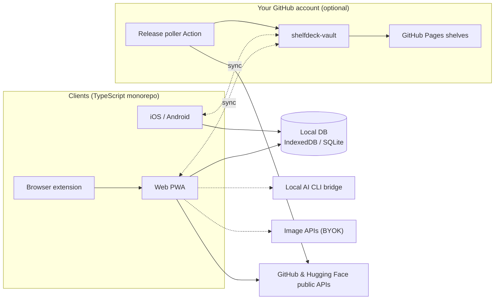

<div align="center">

<a href="https://datarecoveryexpert.github.io/shelfdeck/">
  <picture>
    <source media="(prefers-color-scheme: dark)" srcset="../../site/assets/img/logo-wordmark-dark.png">
    
  </picture>
</a>

<p><strong>開発者のライブラリを、メディアセンターのように。</strong><br>
GitHub のスター、Hugging Face のモデル、各種開発ツールを、見て楽しく検索もできるポスターウォールに。受信トレイを荒らさないリリース追跡も備えています。</p>

<p>
  <a href="https://datarecoveryexpert.github.io/shelfdeck/"><strong>Web サイト</strong></a> ·
  <a href="../../CONTRIBUTING.md"><strong>コントリビュート</strong></a>
</p>

<p>
  
  <a href="../../LICENSE"></a>
  
  
  <a href="https://github.com/datarecoveryexpert/shelfdeck/stargazers"></a>
</p>

<p>
  <a href="../../README.md">English</a> ·
  <a href="README.tr.md">Türkçe</a> ·
  <a href="README.fr.md">Français</a> ·
  <a href="README.es.md">Español</a> ·
  <a href="README.zh-CN.md">简体中文</a> ·
  <b>日本語</b>
</p>


</div>

> [!NOTE]
> **ShelfDeck は現在、設計・仕様策定の段階です。** まだ使えるリリースはなく、以下の画面は開発予定の製品のデザインモックアップです。最初のビルドが出たときに知りたい方は、リポジトリに Star するか Watch してください。

## なぜ ShelfDeck なのか

開発者は毎月、何百ものリポジトリに Star を付け、何十ものモデルに Like を押しています。ところが数週間もすると、なぜ保存したのか、どのプロジェクトで使うつもりだったのか、その間に破壊的変更を含む `v2.0` が出ていたことさえ、誰も覚えていません。

ShelfDeck は、のっぺりとしたスター一覧を、実際に眺めたくなるライブラリに置き換えます。

| 課題 | ShelfDeck の解決策 |
| :--- | :--- |
| **スターの墓場。** 保存したアイテムから個人的な文脈がすっかり抜け落ちる。 | すべてのアイテムに棚、タグ、メモ、導入ステータス（`Inbox`、`Want to Try`、`Using`、`Reference`、`Archived`）を付けられます。 |
| **視覚的な記憶がない。** `owner/repo` という文字列はどれも同じに見える。 | 各アイテムに 2:3 のポスターカバーを用意します。プロジェクト本来のアートワーク、プロシージャル生成のポスター、または自分で生成した AI アートから選べます。 |
| **リリースの見逃し。** リポジトリを Watch すると issue の通知で受信トレイがあふれる。 | 追跡すると決めたアイテムだけを対象にした静かなリリースフィード。破壊的変更にはフラグが付きます。 |
| **デバイスがバラバラ。** スマホで見つけて、ノート PC で試す。 | *自分の* GitHub アカウント内のプライベートリポジトリを使った、オプションの同期機能。ShelfDeck のサーバーもサブスクリプションもありません。 |

## 使い心地をのぞいてみる

<p align="center"><br><sub>人気プロジェクトを ShelfDeck 流に棚へ。デザインコンセプトであり、名称と画像は各権利者に帰属します。</sub></p>

<table>
  <tr>
    <td width="50%"><br><sub><b>ホーム。</b> URL を貼り付けて、Kodi 風の棚を眺めます。</sub></td>
    <td width="50%"><br><sub><b>詳細。</b> 背景画像付きのビューで、メモ、ライセンス、リリース、クイックアクションを確認できます。</sub></td>
  </tr>
  <tr>
    <td><br><sub><b>テーブル。</b> メンテナンス状況の指標付きで、並べ替えもできる高密度なビュー。</sub></td>
    <td><br><sub><b>カンバン。</b> アイテムをドラッグして導入パイプラインを進めます。</sub></td>
  </tr>
  <tr>
    <td><br><sub><b>ポスターグリッド。</b> ソース、言語、タスク、ライセンス、ステータス、棚で絞り込めます。</sub></td>
    <td><br><sub><b>リリース。</b> 追跡中のアイテムだけの静かなフィード。破壊的変更にはフラグが付きます。</sub></td>
  </tr>
  <tr>
    <td><br><sub><b>レーダー。</b> 自分だけのテックレーダー。</sub></td>
    <td><br><sub><b>健全性。</b> 放置されたアイテム、ライセンスの内訳、互換性の警告。</sub></td>
  </tr>
  <tr>
    <td><br><sub><b>比較。</b> 最大 4 つの代替候補を横並びで比べられます。</sub></td>
    <td><br><sub><b>スタック。</b> 「依存」「代替」の関係でつながったプロジェクトのレシピ。</sub></td>
  </tr>
  <tr>
    <td><br><sub><b>Ctrl K。</b> 「X ができるライブラリがほしい」と入力すれば、タイトル、タグ、メモを横断して探します。</sub></td>
    <td><br><sub><b>設定。</b> 3 つのティアを 1 か所で管理。キーはデバイスの外に出ません。</sub></td>
  </tr>
  <tr>
    <td><br><sub><b>共有。</b> 棚を GitHub Pages に公開したり、awesome-list として書き出したりできます。</sub></td>
    <td><br><sub><b>モバイル。</b> ポスターグリッド、詳細画面、共有シートからの取り込み。</sub></td>
  </tr>
</table>

## すぐに始めて、必要に応じて広げる

<table>
  <tr>
    <td width="33%" valign="top">
      <br>
      <h3>1 · すぐ使えるローカルライブラリ</h3>
      <p>サインアップもトークンも不要です。GitHub や Hugging Face の URL を貼り付けると、公開 API からメタデータを一度だけ取得してブラウザに保存します。それ以降はオフラインでも動作します。</p>
    </td>
    <td width="33%" valign="top">
      <br>
      <h3>2 · リリース追跡 &amp; AI カバー</h3>
      <p>自分の GitHub PAT または Hugging Face トークンを追加すれば、スターや Like の一括インポート、リリース追跡、カバー生成ができます。キーはデバイスの外に出ません。</p>
    </td>
    <td width="33%" valign="top">
      <br>
      <h3>3 · 同期 &amp; 共有</h3>
      <p>GitHub を接続すると、プライベートな <code>shelfdeck-vault</code> リポジトリが作成されます。これを介して Web、iOS、Android を同期し、棚を GitHub Pages に公開できます。</p>
    </td>
  </tr>
</table>

## 機能

- **メディアセンター風のブラウジング。** ポスターグリッド、棚のカルーセル、映画館のような詳細ビュー、そして `Ctrl+K` のコマンドパレット。
- **GitHub と Hugging Face の詳細なメタデータ。** スター数、ライセンス、言語、トピック、最新リリース、モデルのパラメータ数、パイプラインタスク、量子化バリエーション。
- **実務で使えるビュー。** テーブル、カンバン、タイムライン、横並び比較、テックレーダー、ライブラリ健全性ダッシュボード。
- **スマートタグとコレクション。** メタデータからの自動タグ付け（`lang:rust`、`task:tts`、`license:mit`）、ルールベースのスマート棚、「代替を探す」アクション。
- **スタックと関係性。** アイテムをプロジェクトのレシピとしてまとめ、「依存」「代替」「置き換え」といった関係を記録できます。
- **ライセンスとリスクのシグナル。** 互換性の警告、メンテナンス状況のバッジ、破壊的変更のフラグ。
- **ブラウザ拡張機能。** GitHub と Hugging Face のページに「Save to ShelfDeck」ボタンを追加します。
- **キュレーションを共有。** 棚を GitHub Pages 上のビジュアルギャラリーとして公開したり、`awesome-list` 形式の Markdown ファイルとして書き出したりできます。

<p align="center"></p>

## カバーエンジン

ほとんどのリポジトリにはポスター画像がないので、ShelfDeck が作ります。カバーはすべて自分のデバイス上で生成されます。

1. **抽出。** カスタムのソーシャルプレビュー画像や README のヒーロー画像を使います。汎用的な定型カードやバッジは除外します。
2. **プロシージャル。** 決定論的でコストゼロの SVG ポスター。*Criterion Dev*、*Terminal Blueprint*、*Model Spec Card* などのテーマがあります。
3. **AI。** ローカルブリッジ経由で契約済みの AI コマンドラインツールを使うか、自前の画像生成 API キー、あるいはローカル GPU 環境を利用します。

<table>
  <tr>
    <td width="50%"><br><sub><b>プロシージャルテーマ。</b> Criterion Dev、Terminal Blueprint、Model Spec Card。</sub></td>
    <td width="50%"><br><sub><b>カバースタジオ。</b> プロシージャル、ローカル CLI ブリッジ、自前の画像 API から選べます。</sub></td>
  </tr>
</table>

## アーキテクチャ



実線の部分はアカウントなしで動作します。破線の部分はオプトインです。ShelfDeck のバックエンドも、中央のユーザーデータベースも存在しません。

## ロードマップ

| フェーズ | 内容 | ステータス |
| :--- | :--- | :--- |
| 1 | 基盤と Web MVP: ローカルライブラリ、プロシージャルカバー、各種ビュー、プロジェクトサイト | 🟡 設計中 |
| 2 | ブラウザ拡張機能、トークン、一括インポート、リリース追跡、awesome-list エクスポート | ⚪ 予定 |
| 3 | Vault 同期、リリースポーリング用 Action、公開棚ギャラリー | ⚪ 予定 |
| 4 | ローカル CLI ブリッジと、複数プロバイダ対応のカバースタジオ | ⚪ 予定 |
| 5 | 共有シートからの取り込みに対応した iOS / Android アプリ | ⚪ 予定 |
| 6 | パッケージレジストリ、AI によるリリースダイジェスト、コミュニティテーマ | ⚪ 予定 |

## モノレポの構成（予定）

```text
shelfdeck/
├── apps/
│   ├── web/            # Next.js PWA and static public shelf viewer
│   ├── mobile/         # Expo (React Native) for iOS and Android
│   └── extension/      # Chrome / Firefox extension (Manifest V3)
├── packages/
│   ├── core/           # Source parsers, Zod schemas, exporters
│   ├── sync-engine/    # Git Trees API sync, diff and merge
│   ├── cover-engine/   # Procedural posters and AI provider adapters
│   ├── local-bridge/   # Node CLI bridging local AI CLIs
│   └── ui/             # Design tokens and poster primitives
├── templates/vault-starter/
└── docs/
```

## コントリビュート

ShelfDeck には、気軽に参加できるコントリビューションの入り口が 4 つあります。**ポスターテーマ**、**ソースアダプタ**、**画像プロバイダアダプタ**、そして**翻訳**です。ほとんどは同期や認証のコードを知らなくても取り組めます。まずは [CONTRIBUTING.md](../../CONTRIBUTING.md) を読み、[行動規範](../../CODE_OF_CONDUCT.md)を守ってください。

セキュリティ上の問題を見つけた場合は、公開 issue を立てずに [SECURITY.md](../../SECURITY.md) をお読みください。

## メンテナー

ShelfDeck は、イスタンブールの **GOLD DATA Teknoloji** でフォレンジックの専門家を務める **a.ceyhan**（[@datarecoveryexpert](https://github.com/datarecoveryexpert)）が開発・メンテナンスしています。

- Web: <https://www.goldverikurtarma.com>
- メール: [a.ceyhan@goldverikurtarma.com](mailto:a.ceyhan@goldverikurtarma.com)
- その他のプロジェクト: [Tahlis™ DiskNabız](https://github.com/datarecoveryexpert/Tahlis-DiskNabiz)（Windows 向けの無料・テレメトリなしのディスク健康状態モニター）

## ブランド

<p align="center"></p>

Paper `#FAF8F4` · Ink `#14161C` · Amber `#F2A516` · Teal `#0E8F80` · Coral `#E5533D`。ロゴファイルは [`site/assets/img`](../../site/assets/img) にあります。

## ライセンス

[MIT](../../LICENSE) © 2026 GOLD DATA Teknoloji
