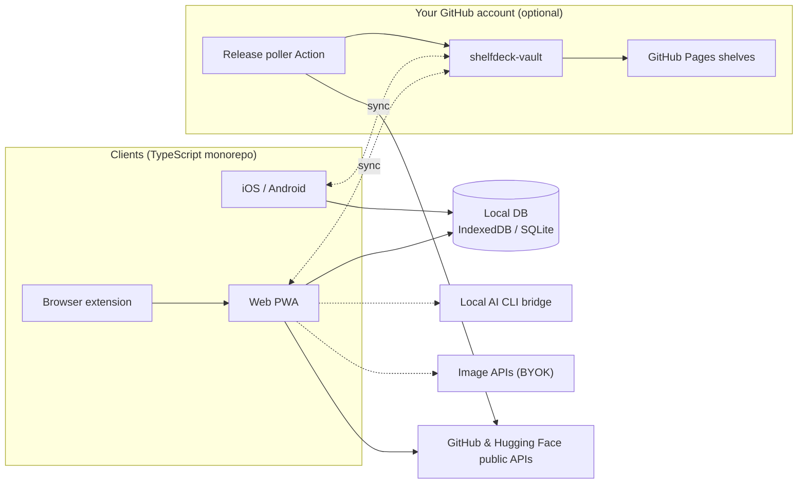

<div align="center">

<a href="https://datarecoveryexpert.github.io/shelfdeck/">
  <picture>
    <source media="(prefers-color-scheme: dark)" srcset="../../site/assets/img/logo-wordmark-dark.png">
    
  </picture>
</a>

<p><strong>Geliştirici kütüphaneniz, bir medya merkezi gibi.</strong><br>
GitHub yıldızlarınızı, Hugging Face modellerinizi ve geliştirici araçlarınızı görsel, aranabilir bir poster duvarına dönüştürün. Sürüm takibi de gelen kutunuzu doldurmadan çalışsın.</p>

<p>
  <a href="https://datarecoveryexpert.github.io/shelfdeck/"><strong>Web sitesi</strong></a> ·
  <a href="../../CONTRIBUTING.md"><strong>Katkıda bulunun</strong></a>
</p>

<p>
  
  <a href="../../LICENSE"></a>
  
  
  <a href="https://github.com/datarecoveryexpert/shelfdeck/stargazers"></a>
</p>

<p>
  <a href="../../README.md">English</a> ·
  <b>Türkçe</b> ·
  <a href="README.fr.md">Français</a> ·
  <a href="README.es.md">Español</a> ·
  <a href="README.zh-CN.md">简体中文</a> ·
  <a href="README.ja.md">日本語</a>
</p>


</div>

> [!NOTE]
> **ShelfDeck şu anda tasarım ve şartname aşamasında.** Henüz kullanılabilir bir sürüm yok; aşağıdaki ekranlar planlanan ürünün tasarım maketleridir. İlk sürüm çıktığında haberdar olmak için repoya yıldız verin veya takip edin.

## Neden ShelfDeck?

Geliştiriciler her ay yüzlerce repoya yıldız veriyor, onlarca modeli beğeniyor. Birkaç hafta sonra hiçbiri neden kaydedildiğini, hangi proje için düşünüldüğünü ya da arada kırıcı bir `v2.0` çıkardığını hatırlamıyor.

ShelfDeck, düz yıldız listesinin yerine gerçekten gezinebileceğiniz bir kütüphane koyar:

| Sorun | ShelfDeck ne yapar |
| :--- | :--- |
| **Yıldız mezarlığı.** Kaydedilen öğeler kişisel bağlamını kaybeder. | Her öğeye raf, etiket, not ve benimseme durumu (`Inbox`, `Want to Try`, `Using`, `Reference`, `Archived`). |
| **Görsel hafıza yok.** `owner/repo` dizgileri birbirine benzer. | Her öğe 2:3 bir poster kapağı alır: projenin kendi görseli, procedural bir poster ya da kendi ürettiğiniz yapay zekâ çizimi. |
| **Kaçan sürümler.** Repoyu izlemek gelen kutusunu issue gürültüsüyle doldurur. | Yalnızca takip etmeyi seçtiğiniz öğeler için sakin bir sürüm akışı; kırıcı değişiklikler işaretlenir. |
| **Cihaz dağınıklığı.** Telefonda keşfedip dizüstünde değerlendirirsiniz. | *Kendi* GitHub hesabınızdaki özel bir repo üzerinden isteğe bağlı senkronizasyon. ShelfDeck sunucusu yok, abonelik yok. |

## Deneyime bir bakış

<p align="center"><br><sub>Popüler projeler, ShelfDeck rafında. Tasarım konseptidir; isimler ve görseller sahiplerine aittir.</sub></p>

<table>
  <tr>
    <td width="50%"><br><sub><b>Ana ekran.</b> Bir URL yapıştırın, Kodi tarzı raflarda gezinin.</sub></td>
    <td width="50%"><br><sub><b>Detay.</b> Notlar, lisans, sürümler ve hızlı işlemlerle arka planlı görünüm.</sub></td>
  </tr>
  <tr>
    <td><br><sub><b>Tablo.</b> Bakım sağlığı sinyalleriyle sıralanabilir yoğun görünüm.</sub></td>
    <td><br><sub><b>Kanban.</b> Öğeleri benimseme sürecinizde sürükleyin.</sub></td>
  </tr>
  <tr>
    <td><br><sub><b>Poster ızgarası.</b> Kaynak, dil, görev, lisans, durum ve rafa göre filtreler.</sub></td>
    <td><br><sub><b>Sürümler.</b> Takip ettiğiniz öğeler için sakin bir akış; kırıcı değişiklikler işaretli.</sub></td>
  </tr>
  <tr>
    <td><br><sub><b>Radar.</b> Kişisel teknoloji radarınız.</sub></td>
    <td><br><sub><b>Sağlık.</b> Bayatlamış öğeler, lisans dağılımı ve uyumluluk uyarıları.</sub></td>
  </tr>
  <tr>
    <td><br><sub><b>Karşılaştırma.</b> Dört alternatife kadar yan yana.</sub></td>
    <td><br><sub><b>Yığınlar.</b> "Bağımlı" ve "alternatifi" bağlantılarıyla proje tarifleri.</sub></td>
  </tr>
  <tr>
    <td><br><sub><b>Ctrl K.</b> "X işini yapan bir kütüphane lazım" yazın; başlıklar, etiketler ve notlar taransın.</sub></td>
    <td><br><sub><b>Ayarlar.</b> Üç katman tek yerde; anahtarlar cihazınızda kalır.</sub></td>
  </tr>
  <tr>
    <td><br><sub><b>Paylaşım.</b> Bir rafı GitHub Pages'te yayınlayın ya da awesome-list olarak dışa aktarın.</sub></td>
    <td><br><sub><b>Mobil.</b> Poster ızgarası, detay ve Paylaş menüsünden kaydetme.</sub></td>
  </tr>
</table>

## Hemen başlayın, istediğiniz kadar büyüyün

<table>
  <tr>
    <td width="33%" valign="top">
      <br>
      <h3>1 · Anında yerel kütüphane</h3>
      <p>Kayıt yok, token yok. Bir GitHub veya Hugging Face URL'si yapıştırın; bilgiler herkese açık API'lerden bir kez çekilip tarayıcınızda saklanır. Sonrasında çevrimdışı çalışır.</p>
    </td>
    <td width="33%" valign="top">
      <br>
      <h3>2 · Sürüm takibi ve yapay zekâ kapakları</h3>
      <p>Kendi GitHub PAT'inizi veya Hugging Face token'ınızı ekleyerek yıldızlarınızı ve beğenilerinizi toplu içe aktarın, sürümleri takip edin, kapak üretin. Anahtarlar cihazınızda kalır.</p>
    </td>
    <td width="33%" valign="top">
      <br>
      <h3>3 · Senkronizasyon ve paylaşım</h3>
      <p>GitHub'ı bağlayın, özel bir <code>shelfdeck-vault</code> reposu oluşsun. Web, iOS ve Android onun üzerinden eşitlenir; rafları GitHub Pages'te yayınlayabilirsiniz.</p>
    </td>
  </tr>
</table>

## Özellikler

- **Medya merkezi deneyimi.** Poster ızgarası, raf kaydırıcıları, sinematik detay ekranı ve `Ctrl+K` komut paleti.
- **Derin GitHub ve Hugging Face bilgisi.** Yıldızlar, lisans, dil, konular, son sürüm, model parametreleri, pipeline görevi ve kuantizasyonlar.
- **Gerçek iş için görünümler.** Tablo, Kanban, zaman çizelgesi, yan yana karşılaştırma, teknoloji radarı ve kütüphane sağlığı paneli.
- **Akıllı etiketler ve koleksiyonlar.** Bilgilerden otomatik etiketler (`lang:rust`, `task:tts`, `license:mit`), kurala dayalı akıllı raflar ve "alternatif bul" işlemi.
- **Yığınlar ve ilişkiler.** Öğeleri proje tariflerinde gruplayın; "bağımlı", "alternatifi", "yerine geçer" bağlantılarını kaydedin.
- **Lisans ve risk sinyalleri.** Uyumluluk uyarıları, bakım sağlığı rozetleri ve kırıcı değişiklik işaretleri.
- **Tarayıcı eklentisi.** GitHub ve Hugging Face sayfalarında "Save to ShelfDeck" düğmesi.
- **Seçkinizi paylaşın.** Rafları GitHub Pages'te görsel galeri olarak yayınlayın ya da `awesome-list` Markdown dosyası olarak dışa aktarın.

<p align="center"></p>

## Kapak motoru

Çoğu reponun poster görseli yoktur, ShelfDeck bunu üretir. Her kapak kendi cihazınızda oluşturulur:

1. **Çıkarma.** Projenin özel sosyal önizlemesi ve README banner'ları; hazır şablon kartlar ve rozetler elenir.
2. **Procedural.** *Criterion Dev*, *Terminal Blueprint* ve *Model Spec Card* gibi temalarda, deterministik ve maliyetsiz SVG posterler.
3. **Yapay zekâ.** Zaten abone olduğunuz bir yapay zekâ komut satırı aracı yerel köprü üzerinden ya da kendi görsel üretim API anahtarınız veya yerel GPU kurulumunuz.

<table>
  <tr>
    <td width="50%"><br><sub><b>Procedural temalar.</b> Criterion Dev, Terminal Blueprint, Model Spec Card.</sub></td>
    <td width="50%"><br><sub><b>Kapak stüdyosu.</b> Procedural, yerel CLI köprüsü ya da kendi görsel API'niz.</sub></td>
  </tr>
</table>

## Mimari



Düz çizgiler hesap olmadan çalışır, kesikli çizgiler isteğe bağlıdır. ShelfDeck'in arka uç sunucusu ve merkezi bir kullanıcı veritabanı yoktur.

## Yol haritası

| Aşama | Odak | Durum |
| :--- | :--- | :--- |
| 1 | Temel ve web MVP: yerel kütüphane, procedural kapaklar, görünümler, proje sitesi | 🟡 Tasarımda |
| 2 | Tarayıcı eklentisi, token'lar, toplu içe aktarma, sürüm takibi, awesome-list dışa aktarma | ⚪ Planlandı |
| 3 | Vault senkronizasyonu, sürüm takip Action'ı, herkese açık raf galerileri | ⚪ Planlandı |
| 4 | Yerel CLI köprüsü ve çok sağlayıcılı kapak stüdyosu | ⚪ Planlandı |
| 5 | Paylaş menüsü desteğiyle iOS ve Android uygulamaları | ⚪ Planlandı |
| 6 | Paket kayıtları, yapay zekâ sürüm özeti, topluluk temaları | ⚪ Planlandı |

## Planlanan monorepo yapısı

```text
shelfdeck/
├── apps/
│   ├── web/            # Next.js PWA ve statik herkese açık raf görüntüleyici
│   ├── mobile/         # iOS ve Android için Expo (React Native)
│   └── extension/      # Chrome / Firefox eklentisi (Manifest V3)
├── packages/
│   ├── core/           # Kaynak ayrıştırıcılar, Zod şemaları, dışa aktarıcılar
│   ├── sync-engine/    # Git Trees API senkronizasyonu, fark ve birleştirme
│   ├── cover-engine/   # Procedural posterler ve yapay zekâ sağlayıcı adaptörleri
│   ├── local-bridge/   # Yerel yapay zekâ CLI köprüsü (Node CLI)
│   └── ui/             # Tasarım token'ları ve poster bileşenleri
├── templates/vault-starter/
└── docs/
```

## Katkıda bulunun

ShelfDeck dört kolay katkı alanıyla tasarlandı: **poster temaları**, **kaynak adaptörleri**, **görsel sağlayıcı adaptörleri** ve **çeviriler**. Bunların çoğu senkronizasyon veya kimlik doğrulama kodunu bilmeyi gerektirmez. [CONTRIBUTING.md](../../CONTRIBUTING.md) ile başlayın ve lütfen [Davranış Kuralları](../../CODE_OF_CONDUCT.md)'na uyun.

Bir güvenlik açığı mı buldunuz? Herkese açık issue açmak yerine [SECURITY.md](../../SECURITY.md) dosyasını okuyun.

## Geliştirici

ShelfDeck'i **a.ceyhan** ([@datarecoveryexpert](https://github.com/datarecoveryexpert)) geliştiriyor; **GOLD DATA Teknoloji**'de adli bilişim uzmanı, İstanbul.

- Web: <https://www.goldverikurtarma.com>
- E-posta: [a.ceyhan@goldverikurtarma.com](mailto:a.ceyhan@goldverikurtarma.com)
- Diğer projeler: [Tahlis™ DiskNabız](https://github.com/datarecoveryexpert/Tahlis-DiskNabiz), Windows için ücretsiz ve telemetrisiz disk sağlığı izleyici

## Marka

<p align="center"></p>

Paper `#FAF8F4` · Ink `#14161C` · Amber `#F2A516` · Teal `#0E8F80` · Coral `#E5533D`. Logo dosyaları [`site/assets/img`](../../site/assets/img) klasöründe.

## Lisans

[MIT](../../LICENSE) © 2026 GOLD DATA Teknoloji
